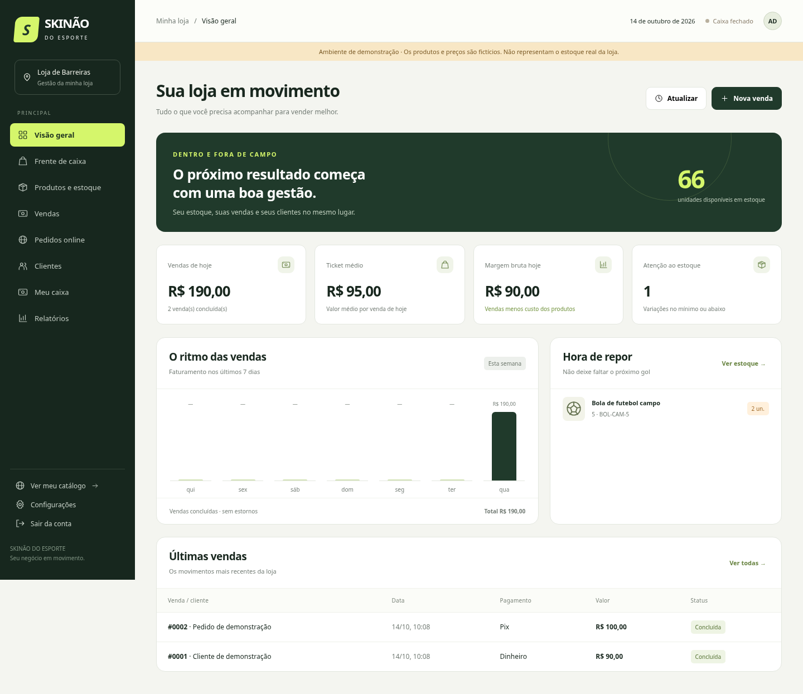
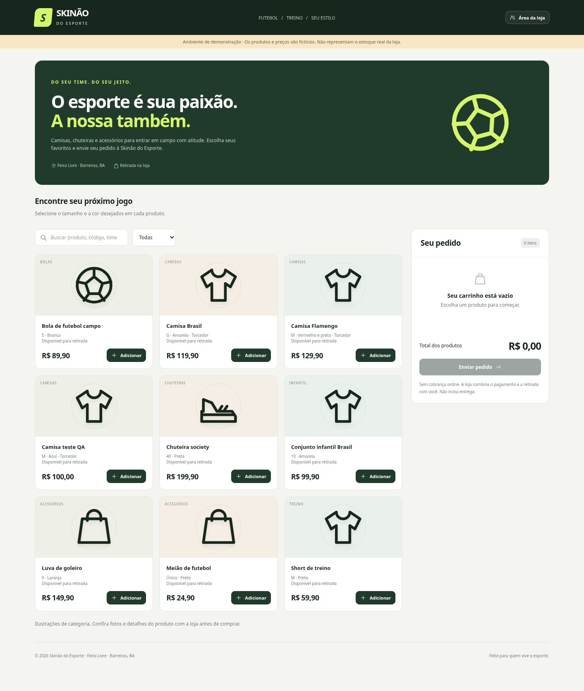

# Skinão do Esporte

Gestão da loja e catálogo com pedidos para a **Skinão do Esporte**, na Feira Livre de Barreiras, Bahia.

**Primeira versão funcional para avaliação local.** A loja virtual recebe pedidos e reserva os produtos; o pagamento e a retirada são combinados com a loja. Este repositório não disponibiliza uma loja hospedada na internet.

## Baixar e experimentar

[**Baixar o aplicativo em ZIP**](https://github.com/Roberttdias/Gest-o-loja/raw/refs/heads/main/downloads/Skinao-do-Esporte.zip)

1. Instale [Python 3.11 ou superior](https://www.python.org/downloads/), caso ainda não tenha.
2. Extraia o ZIP inteiro para uma pasta gravável.
3. No Windows, abra **`DEMONSTRACAO_WINDOWS.bat`** para experimentar com produtos fictícios.
4. O usuário é **`admin`**. A senha aleatória do primeiro acesso aparece na janela do servidor. Guarde-a e mantenha a janela aberta durante o uso.
5. Para iniciar com a base real vazia, encerre a demonstração com Ctrl+C e abra **`INICIAR_WINDOWS.bat`**. Cada base tem sua própria senha inicial.

A gestão abre em <http://127.0.0.1:8000/gestao> e o catálogo em <http://127.0.0.1:8000/catalogo>. Esses endereços funcionam no computador que iniciou o sistema. Não são links públicos para enviar aos clientes.

No Linux ou macOS, na pasta do projeto:

```sh
python3 server.py --open-browser
```

Não é necessário instalar bibliotecas com pip. Veja o [manual completo](LEIA-ME.md) para demonstração em banco separado, backup, senha e acesso em rede.

## Funcionalidades

- Painel com vendas, ticket médio, margem bruta e alertas de estoque.
- Produtos com SKU por tamanho, cor, time e padrão de qualidade.
- Frente de caixa com cliente, desconto, registro de pagamento e recibo interno.
- Abertura, sangria, suprimento e fechamento com conferência do dinheiro físico.
- Catálogo com busca, categorias, carrinho, telefone de contato e envio de pedidos.
- Reserva transacional do estoque e confirmação de pedido em venda sem baixa duplicada.
- Cancelamento de reservas, estorno de vendas do caixa atual e histórico de estoque.
- Cadastro e histórico de clientes, relatórios, exportação CSV e backup SQLite.
- Interfaces para computador e celular.

## Prévia

As imagens usam **dados fictícios de demonstração**. Os produtos e preços não representam o estoque real da empresa. As ilustrações são de categorias; não são fotos dos produtos.

### Gestão



### Catálogo



[Catálogo no celular](docs/previas/catalogo-celular.png) · [Gestão no celular](docs/previas/gestao-celular.png)

## Verificação e referência Nex

**6 testes de acesso e transações passaram**, incluindo disputa pela última unidade, reserva e confirmação sem baixa duplicada, estorno, caixa e backup. Também passaram **13 verificações no Chromium**, com revisão em largura de celular. Consulte [VALIDACAO.md](VALIDACAO.md) para o alcance e os limites.

```sh
python3 -m unittest discover -s tests -v
```

O REA foi usado no executável NexAdmin enviado como referência, com análise estática limitada de cabeçalhos e seções. Não houve decompilação completa nem execução do Nex. A aplicação da Skinão é uma implementação própria, não uma reprodução integral do Nex. O [relatório REA](analise/RELATORIO-REA.md) distingue os resultados observados, as decisões de implementação e as lacunas.

## Limites desta versão

Não inclui emissão fiscal, cobrança real de Pix/cartão, cálculo de frete, importação de dados do Nex ou contas individuais para funcionários. Os recibos são internos e sem valor fiscal. A margem bruta não corresponde ao lucro líquido.

O servidor Python padrão atende ao piloto local. Publicação na internet exige preparar hospedagem de produção, HTTPS, backup externo e controle de acesso. O iniciador Windows foi fornecido, mas os testes desta entrega ocorreram em Linux/Chromium.

O código-fonte está na raiz do repositório; o pacote pronto para extrair está em `downloads/`. Dados reais, senhas, bancos de teste e o executável do Nex não estão incluídos.
